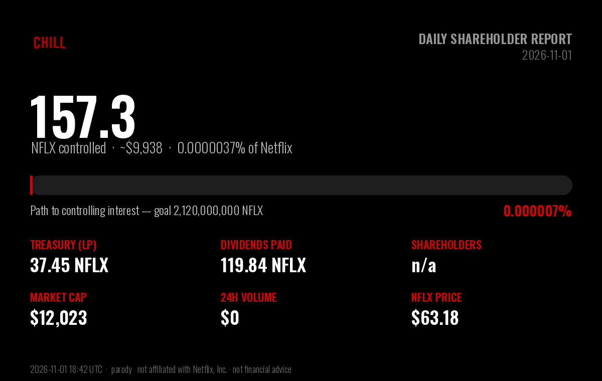

# $CHILL — Daily Shareholder Report

### Netflix and Chill · Report to Shareholders · 2026-11-02

> **Corporate objective:** acquire a controlling interest in Netflix (NFLX).
> Netflix has **4,220,000,000** shares outstanding; a majority
> stake requires **2,120,000,000 NFLX**. $CHILL accumulates NFLX two ways — NFLX held
> in protocol-owned liquidity, and reflections distributed to shareholders.

## Ownership position

| Metric | Value |
|---|---|
| **NFLX under $CHILL control** | **154.32 NFLX** (~$9,597) |
| Stake in Netflix | 0.000003657% of shares outstanding |
| Progress to controlling interest | 0.0000073% of 2,120,000,000 |
| Shares remaining to majority | 2,119,999,846 NFLX |

## Balance sheet — NFLX holdings

| Holding | NFLX | USD |
|---|---|---|
| Treasury (protocol-owned liquidity) | 34.45 | $2,142 |
| Dividends distributed to shareholders | 119.87 | $7,455 |
| **Total NFLX controlled** | **154.32** | **$9,597** |

## Last 24 hours

| Metric | Value |
|---|---|
| Trading volume | 3.30 NFLX (~$205) |
| Net NFLX accumulated | -3.01 NFLX |
| Dividends generated | 0.0330 NFLX |
| Transactions | 4 (3 buys / 1 sells) |
| $CHILL price change | -14.4% |

## Shareholder & market data

| Metric | Value |
|---|---|
| Shareholders of record | n/a |
| Lifetime unique participants | 1823 |
| Shares outstanding ($CHILL) | 1,000,000,000 |
| Market capitalization | $10,294 |
| $CHILL price | $0.00001029 |
| NFLX price | $62.19 |
| Lifetime volume | 11,987.42 NFLX (~$745,490) |
| Lifetime transactions | 8,628 (4,821 buys / 3,807 sells) |
| Days since IPO (launch) | 106 |

## Per-share metrics

| Metric | Value |
|---|---|
| NFLX backing per 1M $CHILL | 0.154323 NFLX |
| Dividends per 1M $CHILL | 0.119874 NFLX |

---

*Report generated 2026-11-02 22:32 UTC · block 104,572,273 · data via the Sentry-Robinhood
subgraph and Robinhood Chain explorer.*

**Disclaimer:** $CHILL is an independent, community-driven **parody** token. It is
**not affiliated with, endorsed by, sponsored by, or connected to Netflix, Inc.**
in any way. This "shareholder report" is satire. $CHILL is not a security, equity,
or claim on Netflix; it does not represent real ownership of Netflix and confers no
shareholder rights. For entertainment only — not financial advice. DYOR.
